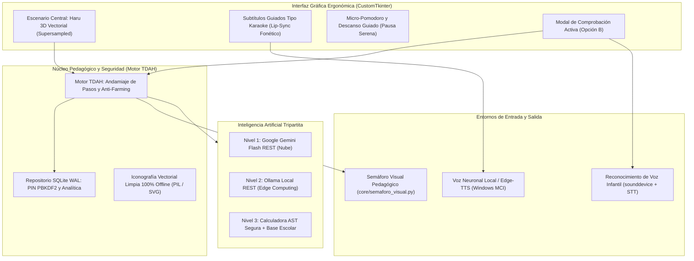

# HARU — Asistente Virtual Educativo para Niños de Primaria con TDAH

**Universidad Salesiana de Bolivia — Carrera de Ingeniería de Sistemas**  
**Proyecto de Grado / Proyecto Integrador:** *Diseño de un asistente virtual para la organización de tareas y el apoyo académico guiado de niños de primaria con TDAH*

---

### Integrantes del Equipo
* Conde Merma Javier Leonardo
* Espinoza Condori Ángel Fernando
* Limachi Llusco Lizeth Gabriela
* Mendoza Conde Rolando Junior
* Nacho Hilari Alexander Aron
* Calle Mamani María Elena
* Mollo Ampuero José Fernando

---

## Arquitectura y Componentes del Sistema



---

## Características Principales

### 1. Descomposición Cognitiva y Micro-Validación Interactiva (Opción B)
* **Andamiaje de Micro-Pasos:** Fracciona tareas escolares extensas en una única acción visible a la vez para mitigar la sobrecarga de la memoria de trabajo.
* **Comprobación Activa No Punitiva:** Al presionar *«¡Paso Listo!»*, Haru formula una micro-pregunta amigable adaptada a la tarea (cálculo aritmético exacto, color usado, útiles escolares o lectura activa) admitiendo botones táctiles o respuesta hablada mediante micrófono (*«Decir en Voz Alta»*).
* **Mecanismo Anti-Farming:** Control estricto de economía de fichas que impide acumular recompensas al retroceder y avanzar repetidamente sobre el mismo paso.

### 2. Avatar Tridimensional Autónomo con Expresiones Situacionales
* **Renderizado Vectorial en Memoria (100% Offline):** Gráficos suavizados mediante supermuestreo 4x (*LANCZOS*) sin requerir GPUs dedicadas ni paquetes pesados.
* **Sincronización Labial Fonética:** 6 visemas bucales enlazados con las formantes del habla que cierran en silencios y pausas de puntuación.
* **10 Comportamientos Situacionales:** Reacciones corporales dinámicas (`IDLE`, `SALUDANDO`, `HABLANDO`, `ESCUCHANDO`, `PENSANDO`, `PASO_LOGRADO`, `CELEBRANDO`, `RESPIRANDO`, `PAUSA` y `COSQUILLAS`).
* **4 Trajes Desbloqueables:** Progreso visual continuo (*Robot Kawaii*, *Gatito Espacial*, *Osito Tutor* y *Súper Haru Dorado*).

### 3. Sistema Híbrido de Inteligencia Artificial y Cumplimiento Legal
* **Privacidad Estricta (Ley N.º 548):** Conmutador de *Modo Privado* en el Panel Docente que bloquea cualquier envío de audio o datos a servidores externos.
* **Tolerancia a Fallos:** Enlace inteligente entre Google Gemini Flash REST, detección automática de modelos locales mediante Ollama (`127.0.0.1:11434`) y evaluación aritmética determinista mediante Árboles de Sintaxis Abstracta (`ast`).

### 4. Iconografía Vectorial Nítida y Reportes Formales
* **Cero Dependencia de Internet:** Iconografía geométrica sobria para CustomTkinter y generación de reportes clínicos/académicos en HTML con gráficos vectoriales SVG incrustados (listos para exportación o impresión en PDF).
* **Seguridad Criptográfica:** Panel Docente protegido mediante PIN de 4 dígitos derivado con PBKDF2-HMAC-SHA256 y bloqueo temporal exponencial contra ataques de fuerza bruta.

---

## Requisitos y Puesta en Marcha

### Requisitos del Sistema
* Windows 10 o Windows 11 (64 bits).
* Python 3.10 o superior (compatible con Python 3.12 y 3.13).
* No requiere Visual C++ Build Tools ni compiladores externos.

### Instalación y Ejecución
1. **Desde código fuente (Python 3.10+):**
   ```bash
   python -m pip install -r requirements.txt
   python main_haru_tdah.py
   ```
   *(También puedes abrir `haru.pyw` para iniciar sin ventana de consola).*

2. **Compilar ejecutable portable `Haru.exe` (sin requerir Python en otras PCs):**
   ```bash
   python tools/compilar_exe.py
   ```

---

## Comandos para Verificación y Calidad

```bash
# Diagnóstico integral del entorno (módulos, micrófono, motor de voz, base de datos y API)
python tools/diagnostico.py

# Ejecución de la suite completa de pruebas unitarias y de integración (20/20 tests)
python -m unittest discover -s tests -v

# Compilación de Haru.exe autónomo en dist/Haru/
python tools/compilar_exe.py

# Generación del archivo portátil distribuible (excluye claves .env y bases .db)
python tools/empaquetar_zip.py
```

---

## Estructura del Repositorio

```text
HARU_TDAH/
├── haru.pyw                      # Lanzador gráfico en modo ventana (sin consola)
├── main_haru_tdah.py             # Punto de entrada estándar del proyecto
├── requirements.txt              # Especificación de dependencias de Python
├── .env.example                  # Plantilla de configuración de variables de entorno
├── .gitignore                    # Reglas de exclusión de credenciales y datos locales
├── core/                         # Lógica de negocio, base de datos y controladores
│   ├── archivos_estudio.py       # Lector local de guías/pensum (.pdf, .docx, .txt, .md, .csv)
│   ├── comprobacion_activa.py    # Motor bilingüe de micro-validación contextual de pasos
│   ├── config.py                 # Gestión de rutas (código fuente y PyInstaller _MEIPASS)
│   ├── eventos.py                # Bus asíncrono y reactivo de eventos de UI
│   ├── motor_tdah.py             # Máquina de estados pedagógica, Pomodoro y retención de foco
│   ├── repositorio_db.py         # Base Relacional SQLite WAL en 3FN (FKs, pasos_tarea y auditoria_eventos)
│   ├── semaforo_visual.py        # Controlador nativo del Semáforo Visual Pedagógico (Inicio, Avance, Meta)
│   ├── herramientas_multimodales.py # Síntesis de tonos y visión computacional
│   ├── ia/                       # Clasificador automático de módulos, AST, Ollama y Gemini REST
│   └── voz/                      # Síntesis TTS fonética y reconocimiento de voz STT
├── ui/                           # Capa de presentación visual (CustomTkinter)
│   ├── app.py                    # Ventana principal con filtro de Módulos y progreso (c/t)
│   ├── avatar_sprite.py          # Renderizador del avatar 3D y cinemáticas
│   ├── iconos.py                 # Motor vectorial offline y generador SVG
│   ├── karaoke.py                # Visualizador de subtítulos sincronizados
│   ├── modales.py                # Diálogos modales (PIN, Álbum, Comprobación y Aprobador de Guías)
│   ├── panel_docente.py          # Dashboard con 5 módulos, micrófono en vivo e ingesta de archivos
│   ├── reto_colores_modal.py     # Componente sensorial con cámara web
│   └── theme.py                  # Definición de paletas cromáticas (Calma, Día, Noche)
├── arduino/                      # Firmware opcional para microcontroladores
│   └── barra_progreso_tdah.ino   # Código C++ de referencia para semáforo de LEDs
├── tests/                        # Batería de pruebas automatizadas
│   ├── test_motor_tdah.py        # Pruebas del motor pedagógico y base de datos
│   └── test_auditoria_integral.py# Pruebas integrales de seguridad, módulos, documentos y UI
└── tools/                        # Utilidades auxiliares
    ├── compilar_exe.py           # Compilador automatizado de Haru.exe (PyInstaller)
    ├── diagnostico.py            # Script de comprobación de salud del sistema
    ├── pregenerar_voz_offline.py # Generador de banco de voz neuronal en caché
    └── empaquetar_zip.py         # Empacador seguro para distribución
```
