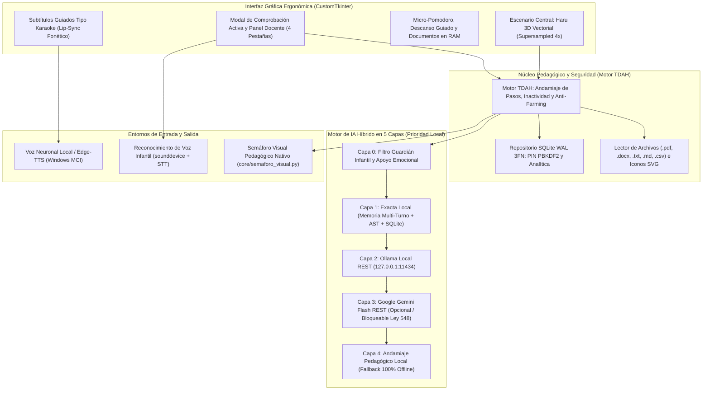

<p align="center">
  
</p>

<p align="center">
  <strong>Asistente virtual educativo para la organización de tareas y el apoyo académico guiado de niños de primaria con TDAH.</strong>
</p>

<p align="center">
  <sub>Universidad Salesiana de Bolivia · Carrera de Ingeniería de Sistemas · Windows 10/11 · Python 3.10–3.14 · Privacidad Ley N.º 548</sub>
</p>

---

### Integrantes del Equipo
* Conde Merma Javier Leonardo
* Espinoza Condori Ángel Fernando
* Limachi Llusco Lizeth Gabriela
* Mendoza Conde Rolando Junior
* Nacho Hilari Alexander Aron
* Calle Mamani María Elena
* Mollo Ampuero José Fernando

---

## Arquitectura y Componentes del Sistema



---

## Características Principales

### 1. Descomposición Cognitiva, Micro-Validación y Retención de Foco
* **Andamiaje de Micro-Pasos:** Fracciona tareas escolares extensas en una única acción visible a la vez para mitigar la sobrecarga de la memoria de trabajo.
* **Comprobación Activa No Punitiva:** Al presionar *«¡Paso Listo!»*, Haru formula una micro-pregunta amigable adaptada a la tarea (cálculo aritmético exacto, color usado, útiles escolares o lectura activa) admitiendo botones táctiles o respuesta hablada mediante micrófono (*«Decir en Voz Alta»*).
* **Recordatorio de Inactividad Configurable:** Detecta pausas prolongadas y activa un aviso empático (*«¿sigues ahí?»*) cuyo umbral en minutos se ajusta desde el Panel Docente.
* **Mecanismo Anti-Farming:** Control estricto de economía de fichas que impide acumular estrellas al retroceder y avanzar repetidamente sobre el mismo paso.

### 2. Documentos del Estudiante en Sesión (`1 ⭐ = 3 ejercicios`)
* **Lectura Local Multi-Formato:** Soporta archivos `.pdf` (mediante `pypdf` y respaldo puro en Python), `.docx`, `.txt`, `.md` y `.csv` sin necesidad de internet.
* **Persistencia 100% en Memoria RAM:** El archivo cargado permanece activo durante toda la sesión para navegar ejercicios de forma continua y se libera automáticamente al cerrar el documento o salir de la aplicación, evitando ocupar espacio innecesario en disco.
* **Navegación Multi-Turno y Verificación AST:** Permite recorrer guías completas (*«siguiente»*, *«los otros ejercicios»*, *«del 10 al 12»*, *«el último»*, *«cerrar archivo»*), verifica resultados matemáticos con Árboles de Sintaxis Abstracta (`ast`) para evitar alucinaciones y aplica un cobro equitativo de **1 estrella por cada 3 ejercicios distintos** del documento.

### 3. Motor Híbrido de IA, Seguridad Infantil y Empatía
* **Filtro Guardián Infantil (Capa 0):** Detecta lenguaje hostil, situaciones de acoso escolar (*bullying*) o intentos de evasión, responde con contención emocional cálida y aplica excepciones académicas para no bloquear tareas legítimas.
* **Comprensión Infantil y Memoria Multi-Turno:** Normaliza errores comunes de escritura infantil y mantiene el contexto conversacional reciente para preguntas de seguimiento.
* **Prioridad Local y Privacidad (Ley N.º 548):** Resuelve primero con calculadora determinista AST y base escolar SQLite; continúa con **Ollama Local** (`127.0.0.1:11434`), recurre opcionalmente a **Google Gemini Flash REST** y cierra con andamiaje 100% offline. El *Modo Privado* del Panel Docente bloquea por completo cualquier envío a la nube.

### 4. Avatar Tridimensional Autónomo y Semáforo Visual Nativo
* **Renderizado Vectorial en Memoria (100% Offline):** Gráficos suavizados mediante supermuestreo 4x (*LANCZOS*) sin requerir GPUs dedicadas ni motores pesados.
* **Sincronización Labial Fonética:** 6 visemas bucales sincronizados con el habla y subtítulos tipo karaoke palabra por palabra.
* **10 Comportamientos Situacionales y 4 Trajes Desbloqueables:** Reacciones dinámicas (`IDLE`, `SALUDANDO`, `HABLANDO`, `ESCUCHANDO`, `PENSANDO`, `PASO_LOGRADO`, `CELEBRANDO`, `RESPIRANDO`, `PAUSA` y `COSQUILLAS`) y evolución visual (*Robot Kawaii*, *Gatito Espacial*, *Osito Tutor* y *Súper Haru Dorado*).
* **Semáforo Visual Pedagógico Nativo:** Indicador de 3 luces integrado en pantalla (*Inicio*, *Avance*, *Meta*) controlado desde `core/semaforo_visual.py`, sin requerir placas ni cables externos.
* **Zona de Juegos Cognitivos (`ui/juegos_modal.py`):** Minijuegos integrados (*Tres en Raya* con 3 dificultades/Minimax/pistas y *Memorama* visual de 2 niveles) que entrenan planificación, memoria de trabajo y otorgan `+1 ⭐` al ganar.

### 5. Panel Docente y Familiar (4 Pestañas)
Protegido mediante PIN de 4 dígitos derivado con **PBKDF2-HMAC-SHA256** y bloqueo temporal progresivo contra intentos fallidos:
1. **Misiones y Pasos:** Constructor visual tarjeta por tarjeta, Descomponedor IA y carga asíncrona de documentos escolares con barra de progreso en tiempo real.
2. **Progreso y Descansos:** Indicadores clave (KPIs), gráficos de foco/pausas, bitácora detallada y exportación de reportes en CSV y HTML con gráficos SVG incrustados listos para imprimir en PDF.
3. **Voz, Reloj e IA:** Selector de voces neuronales (Bolivia/Latam), tiempos Micro-Pomodoro, umbral de inactividad configurable, Comprobación Activa, tarjeta **Ollama Local** (LED de estado verde/rojo, modelo activo y selector dinámico), conmutador de *Modo Privado* y prueba de Gemini.
4. **Seguridad y Perfil:** Cambio de PIN cifrado, **Perfil Pedagógico del Estudiante** (nombre y grado de `1.°` a `6.° de Primaria`), botones de prueba en vivo del Semáforo Visual y resumen del marco legal.

---

## Requisitos, Distribución y Puesta en Marcha

### Requisitos del Sistema
* Windows 10 o Windows 11 (64 bits).
* Python **3.10 a 3.14** (solo si se ejecuta desde el código fuente de GitHub).
* No requiere Visual C++ Build Tools ni compiladores externos instalados por el usuario.

### Dos Modos de Uso

#### Opción A — Desde Código Fuente (GitHub)
1. Clona o descarga el repositorio y abre **`haru.pyw`** (doble clic):
   * Valida automáticamente que el equipo cuente con **Python 3.10+** y `pip`.
   * Detecta qué dependencias ya están instaladas y descarga únicamente las faltantes mostrando una **barra de carga visual animada** (sin duplicar descargas).
2. O instálalo y ejecútalo manualmente desde terminal:
   ```bash
   python -m pip install -r requirements.txt
   python main_haru_tdah.py
   ```

#### Opción B — Paquete Portable `.zip` (`Haru.exe`)
Ideal para compartir con docentes, familias o compañeros sin instalar Python:
1. Descomprime el archivo generado con `python tools/empaquetar_zip.py`.
2. Ejecuta **`Haru.exe`** directamente. Incluye un lanzador nativo de Windows (compilado con `csc.exe`, sin ventana de consola) junto a un entorno **Python 3.14 embebido** y todas las dependencias listas en `_internal/`.

### Configuración Opcional de IA (`.env` y Ollama)
Haru funciona al 100% sin claves ni internet, pero puedes potenciar las explicaciones con IA generativa:
* **Ollama Local (Privado y Offline):** Instala [Ollama](https://ollama.com/), descarga un modelo ligero (por ejemplo `ollama pull gemma3:4b` o `llama3.2:3b`) y selecciona el modelo directamente desde *Panel Docente → 3. Voz, Reloj e IA*.
* **Google Gemini (Opcional en la Nube):** Copia `.env.example` a `.env` y define `GEMINI_API_KEY=tu_clave`. Asegúrate de mantener desactivado el *Modo Privado* si deseas usar la nube.

---

## Comandos para Verificación y Calidad

```bash
# Diagnóstico integral del entorno (módulos, micrófono, voz, base de datos, Ollama y API)
python tools/diagnostico.py

# Ejecución de la suite completa de pruebas unitarias y de integración (31/31 tests)
python -m unittest discover -s tests -v

# Compilación de Haru.exe autónomo (lanzador nativo C# + Python embebido en dist/Haru/)
python tools/compilar_exe.py

# Generación del paquete .zip portable (excluye claves .env, logs y bases .db locales)
python tools/empaquetar_zip.py
```

---

## Estructura del Repositorio

```text
HARU_TDAH/
├── haru.pyw                         # Lanzador gráfico con validación Python 3.10+ e instalador con barra visual
├── main_haru_tdah.py                # Punto de entrada estándar del proyecto
├── requirements.txt                 # Especificación de dependencias de Python
├── .env.example                     # Plantilla de configuración de variables de entorno (Gemini / Ollama)
├── .gitignore                       # Reglas de exclusión de credenciales, compilados y bases locales
├── assets/                          # Recursos visuales y multimedia del proyecto
│   └── img/                         # Icono oficial (haru_icon.ico), banner (haru_banner.png) e ilustraciones
├── core/                            # Lógica pedagógica, base de datos y controladores
│   ├── archivos_estudio.py          # Lector local de documentos (.pdf, .docx, .txt, .md, .csv)
│   ├── comprobacion_activa.py       # Motor de micro-validación contextual de pasos
│   ├── config.py                    # Gestión centralizada de rutas (código fuente y entorno portable)
│   ├── eventos.py                   # Bus asíncrono y reactivo de eventos de UI
│   ├── motor_tdah.py                # Máquina de estados pedagógica, Pomodoro, inactividad y economía de fichas
│   ├── repositorio_db.py            # Base relacional SQLite WAL en 3FN (PIN PBKDF2, pasos y auditoría)
│   ├── semaforo_visual.py           # Controlador nativo del Semáforo Visual Pedagógico (Inicio, Avance, Meta)
│   ├── herramientas_multimodales.py # Síntesis de tonos y visión computacional (Reto de Colores)
│   ├── ia/                          # Filtro Guardián, calculadora AST, memoria multi-turno, Ollama y Gemini REST
│   └── voz/                         # Síntesis TTS neuronal (Edge-TTS/MCI) y reconocimiento de voz STT
├── ui/                              # Capa de presentación visual (CustomTkinter)
│   ├── app.py                       # Ventana principal, filtro de módulos, chat con documentos y Semáforo Visual
│   ├── avatar_sprite.py             # Renderizador vectorial del avatar 3D y cinemáticas
│   ├── iconos.py                    # Motor de iconografía vectorial offline y generador SVG
│   ├── juegos_modal.py              # Zona de Juegos Cognitivos (Tres en Raya y Memorama)
│   ├── karaoke.py                   # Visualizador de subtítulos sincronizados palabra por palabra
│   ├── modales.py                   # Diálogos modales (PIN, Álbum, Comprobación y Aprobador de Guías)
│   ├── panel_docente.py             # Dashboard en 4 pestañas (misiones, reportes, Ollama/voz y perfil/seguridad)
│   ├── reto_colores_modal.py        # Reto sensorial interactivo con cámara web
│   └── theme.py                     # Paletas cromáticas ergonómicas (Calma, Día, Noche)
├── tests/                           # Batería de pruebas automatizadas (31 tests)
│   ├── test_motor_tdah.py           # Pruebas del motor pedagógico, base de datos y semáforo visual
│   └── test_auditoria_integral.py   # Pruebas integrales de seguridad, IA, documentos, sesiones y UI
└── tools/                           # Utilidades de compilación, empaquetado y diagnóstico
    ├── compilar_exe.py              # Compilador de Haru.exe (lanzador C# csc.exe + Python 3.14 embebido)
    ├── diagnostico.py               # Comprobación rápida e integral de salud del sistema
    ├── pregenerar_voz_offline.py    # Generador de banco de voz neuronal en caché
    └── empaquetar_zip.py            # Empacador portable seguro para distribución
```
